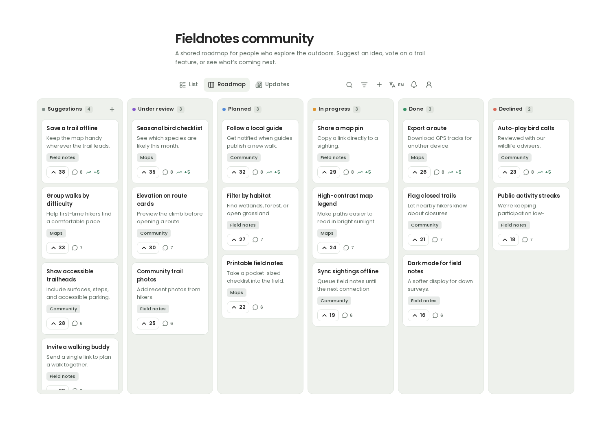

# kiska

kiska hosts feedback boards, roadmaps and community updates. One installation supports multiple organizations. The Rust service serves the API, initial public HTML and built React applications. PostgreSQL stores accounts, board content, sessions, jobs and media references. Private SeaweedFS stores processed images.

[Launch specification](docs/spec.md) · [Performance results and release verification](docs/launch-verification.md)



## Run locally with email

Install Docker Engine with Compose v2 or newer. From the repository root, generate a local environment once.

```sh
umask 077
python3 - <<'PY'
from pathlib import Path
import secrets
config = Path('.env.example').read_text()
for name in ('POSTGRES_PASSWORD','AWS_ACCESS_KEY_ID','AWS_SECRET_ACCESS_KEY','IP_HASH_KEY'):
    config = config.replace(name+'=\n', name+'='+secrets.token_hex(32)+'\n')
with Path('.env').open('x') as destination:
    destination.write(config)
PY
export COMPOSE_FILE=compose.yaml:compose.dev.yaml
docker compose up --build --wait -d
```

Open [the creator workspace](http://localhost:8080/app), register, open the verification link in [the development inbox](http://localhost:8025), sign in and create an organization. Publish a board to obtain its public link. The inbox captures outgoing email locally. To stop the installation while retaining its data, run `docker compose down`.

## Deploy on one VPS

1. Keep the generated `.env` private. Set `PUBLIC_ORIGIN` to the external HTTPS origin, such as `https://app.usekiska.com`, without a trailing slash. Discord previews use this origin for canonical links and images. Set `SMTP_HOST`, `SMTP_PORT`, `SMTP_FROM` and the relay credentials. Reserve `/kiska-media/` on the public origin. Set account `SUPPORT_URL` and `POLICY_URL` if desired.
2. Provide an HTTPS reverse proxy that preserves the incoming Host, path and query string. Forward all requests to the loopback port selected by `HTTP_PORT`. The bundled Nginx gateway routes signed reads to S3 and all other application requests to Axum. It restricts exposed S3 methods and paths and sets `Cache-Control: private, no-store`. Configure your outer proxy or CDN to honor this policy. Database, S3 write access, SMTP sink and SeaweedFS management interfaces stay on Docker networks in the production configuration.
3. Set a stable proxy network and trusted addresses if `10.201.91.0/24` overlaps an existing network. `PROXY_SUBNET`, `PROXY_IP` (bundled gateway) and `HTTPS_PROXY_IP` (outer proxy peer as seen by that gateway) must match the installation. The outer proxy must overwrite the client-address header using the real connection address. Keep `IP_HASH_KEY` stable for existing abuse signals.
4. Run the production Compose file. Migrations run once before the app and worker start. The worker delivers the durable email queue and removes expired staging and deleted objects. Both processes use the same image. The first build downloads and compiles locked dependencies.

   ```sh
   unset COMPOSE_FILE
   docker compose up --build -d --wait
   curl -fsS http://127.0.0.1:8080/readyz
   docker compose ps
   ```

For an existing installation, keep its Compose project name, PostgreSQL role and database, and S3 bucket. Set `COMPOSE_PROJECT_NAME`, `POSTGRES_USER`, `POSTGRES_DB`, and `S3_BUCKET` in its private `.env` before applying the rebrand. This reconnects the services to their existing volumes and media.

The hosted installation serves the static homepage from [landing](landing) at `usekiska.com`. Copy its contents to `/var/www/kiska-landing`. The [host Nginx configuration](ops/proxy/marketing-site.conf) serves the homepage, redirects existing board links, and forwards `app.usekiska.com` to the Compose gateway.

With Caddy on the host, the following site block terminates TLS. Replace the hostname and port with your values.

```caddyfile
app.usekiska.com {
    reverse_proxy 127.0.0.1:8080 {
        header_up Host {http.request.hostport}
        header_up X-Forwarded-For {remote_host}
    }
}
```

Grant instance-operator access to a registered, verified account using `docker compose run --rm app operator organizer@example.org`. Use the workspace for organization-specific administration. Observe application and worker logs using `docker compose logs -f app worker`.

## Back up and recover

Use Docker Compose, Bash and GNU coreutils on the host. The tools image includes the matching PostgreSQL client and an S3 client. The backup process briefly stops the application and worker. Finish any operator CLI jobs first. Plan disk space for the database dump, the full object store and a second copy of the objects when verifying restore.

1. Mount a private directory and capture a consistent snapshot. Supply a **new** directory path. The script records which writer services were running, stops them, captures the database and bucket, verifies the stored sizes of ready database references, and restarts those services. It writes a checksum manifest last. A completed snapshot contains `db.dump`, `objects/`, `media.refs`, `objects.sha256` and `snapshot.sha256`.

   ```sh
   ops/backup/run.sh "/srv/kiska-backups/$(date -u +%Y%m%dT%H%M%SZ)"
   ```

2. Transfer the completed capture off the VPS over an authenticated, encrypted connection to storage with private permissions, retention and encryption at rest. For example, send the snapshot directory to a preconfigured, encrypted remote backup host using `rsync -a -e ssh -- "$snapshot/" "backup-host:/private/kiska/$snapshot_name/"`. Separately protect and back up the deployment revision, `.env`, TLS configuration and the keys required to decrypt backups. The dump contains user data and potentially deliverable messages. Treat the dump, object bytes and keys as sensitive.
3. Retrieve the snapshot and configuration on the recovery host. Set `COMPOSE_PROJECT_NAME` to a fresh name. Configure a local mail sink while rehearsing and keep public traffic off the target. Start with empty database and storage volumes. `ops/restore/run.sh` checks archive hashes, checks the target is empty, uploads the objects, downloads and verifies their checksums, restores PostgreSQL in one transaction, and compares the restored DB references with the capture. A failed import may have already copied objects. Retry using fresh empty volumes.

   ```sh
   export COMPOSE_PROJECT_NAME=kiska_recovered
   export COMPOSE_FILE=compose.yaml:compose.dev.yaml
   ops/restore/run.sh /srv/restored-backup
   docker compose up -d --wait
   ```

4. Verify a published page and its image, pending image access using the author's recovered browser identity, organization media usage, and the queue. For production cutover, restore the original public HTTPS origin, configure the real relay, remove the development overlay and direct incoming requests to the recovered installation. Keep the original capture until these checks pass.

Run `make compose-smoke` for a fresh installation and restart or `make restore-drill` for a full capture and restore into a second project. The drills create temporary credentials, volumes, loopback ports, a mail sink and a small image fixture. They exercise account verification, guest identity recovery, moderation, signed download expiry and queue persistence. Their cleanup removes only their generated Compose projects.


## Development and release checks

Use the supported Node version from CI (24), a Rust toolchain supporting the 2024 edition, Docker Compose, and PostgreSQL client tools. From the repository root:

| Command | What it verifies |
| --- | --- |
| `make test` | Rust API and database tests in disposable PostgreSQL, frontend type checking, unit tests, and generated OpenAPI/TypeScript drift. |
| `make build` | Separate production web bundles, precompressed static assets, and the release Rust executable. |
| `make contract` | Regenerates the OpenAPI document and TypeScript types after an API change. |
| `make e2e` | Starts a disposable production image with PostgreSQL, SeaweedFS and Mailpit, seeds community data, provisions a test operator, and runs browser journeys. |
| `make perf` | Builds the same stack, seeds 10,000 posts and a 1,000-comment thread, and measures mobile and desktop separately. Writes samples, build identity, browser profiles, and traces to `artifacts/perf/`. |
| `make compose-smoke` and `make restore-drill` | Exercise service restarts, object permissions, real SMTP delivery into the test inbox, and database plus media restoration into new volumes. |

Install the test browser once with `npm --prefix web ci` and `(cd web && npx playwright install chromium)`. The browser and performance targets require Bash, Python 3, `flock`, and `psql` on the host. The performance profiles use Chromium emulation on the host CPU. Full release measurements use a quiet machine. Each test stack is removed when its command exits.

The operator screen sets the default free allowances for newly registered creators and newly created organizations. Existing account and organization limits can be changed individually. The Compose environment exposes `KISKA_RATE_*` settings for signup, login, identity and organization creation, uploads, and feedback actions. Signup, login and password recovery use a 15-minute window. Organization creation, uploads and guest posting use a one-hour window.

Published announcements create one durable delivery job per verified recipient. Retries reuse the same Message-ID. If an SMTP relay accepts mail and loses the connection before acknowledging it, it can deliver a retry twice. The worker rechecks board visibility and recipient eligibility before delivery.

Seeded avatars use the Lorelei artwork by Lisa Wischofsky through DiceBear. The bundled Poppins font includes its [license](web/public/assets/poppins-license.txt).
